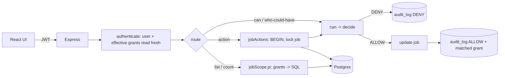
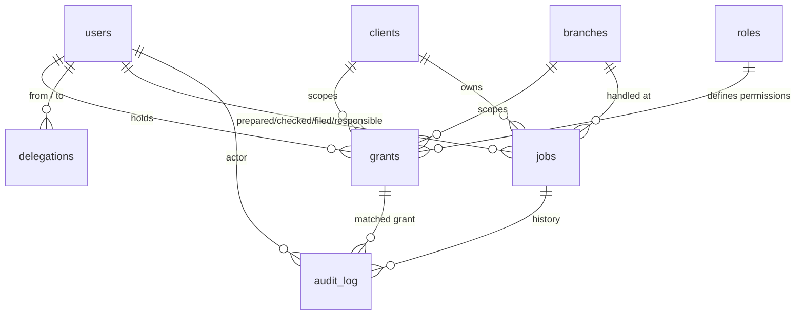

# ARCHITECTURE

## Folder structure

```
nfpl-access-control/
├── backend/
│   ├── db/            schema.sql · migrate.js · seed.js · seedScale.js
│   ├── src/
│   │   ├── app.js index.js config.js db.js
│   │   ├── middleware/   auth.js (JWT + fresh user + fresh grants per request) · errors.js
│   │   ├── permissions/  actions.js (action catalogue) · grants.js (load effective grants) · can.js (decide/can) · whoCouldHave.js
│   │   ├── queries/      jobScope.js (grants -> SQL for view / waiting / list)
│   │   ├── services/     jobActions.js (transactional action runner) · audit.js
│   │   └── routes/       auth · jobs · grants · delegations · parser
│   └── tests/            60 Vitest tests (real Postgres, schema nfpl_test)
└── frontend/src/         App · api · components/{Login,Dashboard,JobDetail,WhyPanel,GrantsAdmin}
```

## Request flow



## Schema (ER overview)



Key columns: `grants(user_id, role, client_id, branch_id, direction, mode, valid_from, valid_to, created_by, revoked_at, revoked_by)` with NULL = all; `roles(name, permissions[], grantable_roles[])`; `jobs(stage, prepared_by, checked_by, filed_by, responsible_user_id, internal_notes, cancelled_from_stage …)`; `audit_log(ts, actor_id, action, job_id, from_stage, to_stage, decision, reason, matched_grant_id, meta jsonb)`. Triggers make `audit_log` append-only and `grants` delete-proof and scope-immutable.

## `can()` decision flow

`decide({user, grants, action, job})` evaluates every check without short-circuiting, so the UI can show the whole breakdown:

1. **user** exists and is active, **action** known, **job data** complete and stage valid. Otherwise DENY with `unsure: true` (and an `unsure:<action>` audit row).
2. **permission**: does any held grant's role include the action's permission?
3. **scope**: does one of those grants cover the job's client/branch/direction/mode? (Reports each grant's limit when none does.)
4. **filed-authority**: cancelling/reopening a Filed (or cancelled-from-Filed) job also needs `job.cancel_filed` / `job.reopen_filed` on the same grant.
5. **stage**: the job's stage allows the action, and the stage is not blocked (`admin_fix`/parser: never Filed).
6. **maker-checker** (check only): not the preparer; and a grant delegated *by* the preparer doesn't count.
7. **reason** (cancel, reopen, admin_fix, reassign) when executing.

Allowed only if all pass and at least one eligible grant remains; the matched grant (own preferred over delegated) is written to the audit row. `jobActions.performAction` wraps this in a transaction: `SELECT … FOR UPDATE` on the job, `can()`, update, audit. Denials are audited and committed too.

## The waiting query

`loadEffectiveGrants` returns the user's own grants plus delegated ones (already narrowed). `waitingWhere` emits, for each of prepare/check/file and each grant carrying that permission:

```sql
(stage = ANY($stages) AND client_id = $c AND branch_id = $b AND direction = $d AND mode = $m   -- only the non-NULL dims
 [AND prepared_by IS DISTINCT FROM $user [AND prepared_by IS DISTINCT FROM $delegator]])       -- check only
```

OR-ed together. The list (`ORDER BY id DESC LIMIT n+1 OFFSET …`), the badge count and the list `total` use this same string. `viewWhere` does the same for visibility. The optional `?q=` ref search only narrows the list.

Indexes: `jobs(stage, client_id, branch_id, direction, mode)` for the filter, `jobs(id DESC)` for ordered paging, `jobs(client_id, id DESC)`, partial index on `responsible_user_id`; `grants(user_id) WHERE revoked_at IS NULL`; `audit_log(job_id, ts)` and `(actor_id, ts)`.

## Performance at 200k jobs / 500 users

Measured on the scale seed (200,312 jobs, 500 users, 904 grants), local Postgres 16, warm, server-side query time only (add network latency on Neon):

| User | Waiting jobs | Waiting page (25) | Count | "All" page |
|---|---|---|---|---|
| maker.all (3 grants) | 88,106 | 35 ms | 28 ms | 2 ms |
| checker.all | 40,183 | 15 ms | 13 ms | 2 ms |
| checker.narrow (1 narrow grant) | 422 | 5 ms | 1 ms | 2 ms |
| scale users (1–3 grants) | 2.6k–7.9k | 5–7 ms | 2–5 ms | ~1 ms |
| client user | 0 | <1 ms | <1 ms | <1 ms |

Approach: filter in SQL (never fetch then filter in Node), page with `LIMIT/OFFSET` and `LIMIT n+1` instead of counting for the "all" view, authorize from 1–3 grant rows per user, no caching. Honest limits: for a very narrow grant the planner walks `id DESC` and filters (≈10k rows examined in the 422-job case, 2 ms); at tens of millions of jobs a partial index on the open stages or keyset paging would be the next step. The broadest waiting counts are the slowest (a full scan of matches, ~30 ms).

## Decision log

**Postgres over Mongo.** *Why:* grants, jobs and audit are relational; we need FKs, CHECKs, triggers for immutability, transactions with row locks, and one SQL statement for scoped filtering and paging. *Rejected:* Mongo with embedded permissions, because scoped list queries and "who held X on date D" become application-side joins, and immutability would be convention only.

**Grants with NULL wildcards.** *Why:* one row shape expresses every slice; reconstruction by date is a plain range query. *Rejected:* a role-per-combination ("Checker-Acme-Mumbai-Import") that explodes into hundreds of roles, and per-job ACLs that don't survive new jobs arriving daily.

**Roles as data.** *Why:* new role = insert, no deploy; the workflow-to-permission mapping stays in code where it is stable. *Rejected:* hard-coded role checks (`if role === 'Checker'`), which need a release for every new role.

**Evaluate at action time, no caching.** *Why:* revocation must be immediate; at 1–3 grants per user it costs milliseconds. *Rejected:* permissions embedded in the JWT (stale for 8 hours) and a grants cache with invalidation (more moving parts, a staleness window).

**Append-only audit + never-deleted grants.** *Why:* "nobody could say who was allowed" is the incident this system exists to prevent; history must survive revocation and be tamper-resistant even against application bugs. *Rejected:* soft-delete flags enforced only in code, and logging to files.

**JWT-only auth.** *Why:* the brief asked for minimal; the token carries only the user id and everything else is re-read per request. *Rejected:* server sessions and refresh tokens (more state, no benefit for a demo); SSO (out of scope, noted in DESIGN).

**Delegation resolved live instead of copying grants.** *Why:* cannot exceed the delegator, expires and shrinks on its own, one source of truth. *Rejected:* materializing temporary grants for the delegate, which would need clean-up and could outlive the delegator's own access.

**Pure `decide()` plus a SQL builder (two encodings of one rule set).** *Why:* the UI explanation needs a rich per-check result, while lists need set-based SQL. *Mitigation:* a test compares them for 11 users over all jobs. *Rejected:* calling `can()` per job when listing (N+1 and unpageable) and SQL-only (no readable explanations).
